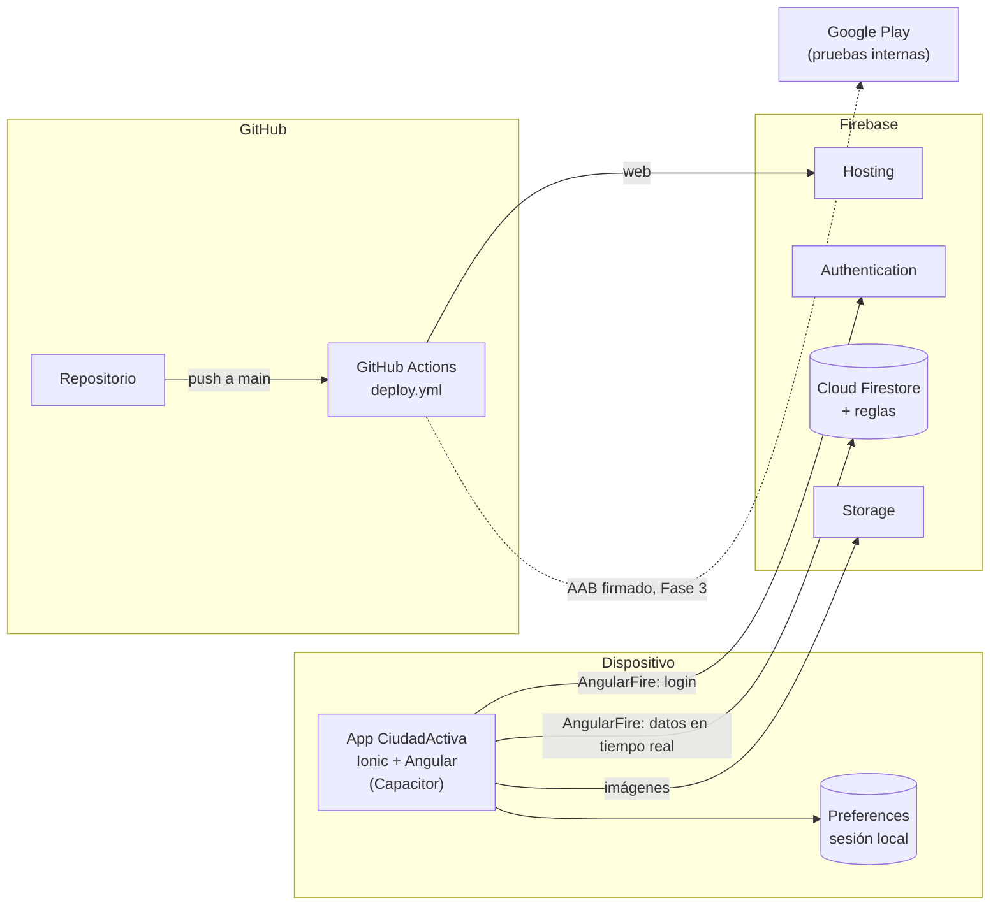

# Arquitectura de CiudadActiva

CiudadActiva es una app móvil híbrida hecha con Ionic + Angular que se conecta directamente a Firebase. No tiene backend propio: la app usa los SDK de Firebase (a través de AngularFire) y la seguridad de los datos la ponen las reglas de Cloud Firestore.

## Tecnologías

| Herramienta | Para qué la usamos |
|---|---|
| Ionic + Angular | Interfaz de la app (componentes `ion-*`), enrutador y modo Material Design (`md`). |
| TypeScript | Lenguaje de toda la lógica de la app. |
| Capacitor + Android Studio | Empaquetar la app web como app Android y generar el AAB firmado. |
| Firebase Authentication | Registro e inicio de sesión de los usuarios. |
| Cloud Firestore | Base de datos del dominio (colecciones `users`, `categories`, `reports`, `report_status_history`, `comments`). |
| Firebase Storage + Cloud Messaging | Fotos de las incidencias y notificaciones push (Fase 3). |
| Firebase Hosting | Publicación de la versión web. |
| Capacitor Preferences | Guardar la sesión en el dispositivo. |
| GitHub + GitHub Actions | Control de versiones y pipeline que construye y publica la web. |
| Google Play Console | Publicación del AAB en la pista de pruebas internas. |
| Jira | Épicas, historias de usuario y sprints. |

## Capas de la app

- **Páginas y componentes** (`src/app/pages`, `src/app/components`): muestran datos y reciben lo que hace el usuario. No llaman a Firebase directamente.
- **Servicios** (`src/app/services`): son la frontera con Firebase. `AuthService` maneja la sesión, `DataService` lee y escribe en Firestore y `StorageService` guarda la sesión con Capacitor Preferences.
- **Modelos** (`src/app/models`): interfaces de TypeScript (`User`, `Report`, `Category`) y los tipos de rol y estado.
- **Guards** (`src/app/guards`): protegen las rutas según la sesión y el rol.
- **Reglas de Firestore** (`firestore.rules`): la autoridad final sobre quién puede leer o escribir cada documento.

## Cómo interactúa el stack



## Estructura del repositorio

```
ciudad-activa/
├── src/
│   ├── app/
│   │   ├── pages/          # login, home, reports, map, management, admin
│   │   ├── components/     # report-card, empty-state
│   │   ├── services/       # auth, data, storage
│   │   ├── models/         # user, reporte, category, enums
│   │   ├── guards/         # auth.guard, role.guard
│   │   ├── app.config.ts   # providers de Firebase (AngularFire)
│   │   └── app.routes.ts   # rutas de la app
│   ├── environments/       # environment.example.ts (los reales no se suben)
│   └── theme/              # colores (modo md)
├── docs/                   # diagramas y diccionario de datos
├── scripts/set-env.mjs     # genera los environment desde variables de entorno
├── firestore.rules
├── firestore.indexes.json
├── firebase.json
├── .github/workflows/deploy.yml
└── capacitor.config.ts
```

## Decisiones

- **Sin backend propio.** Así lo pide el curso. Toda la protección de datos depende de `firestore.rules`, por eso las reglas se versionan junto al código.
- **Angular 21.** AngularFire 21 (la versión estable) todavía no soporta Angular 22, así que fijamos Angular 21.2.
- **Los `environment.ts` no se suben.** En local se copian desde `environment.example.ts` (o se generan con `npm run env`). En el pipeline se generan con los secretos de GitHub.
