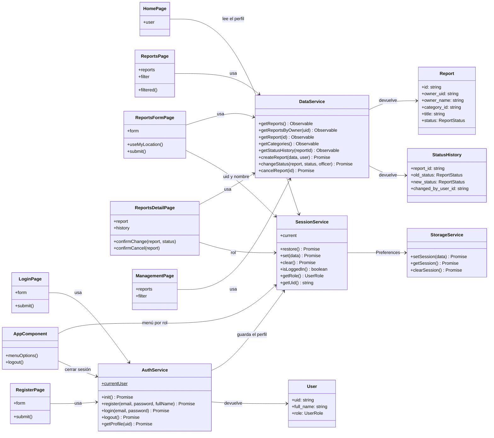
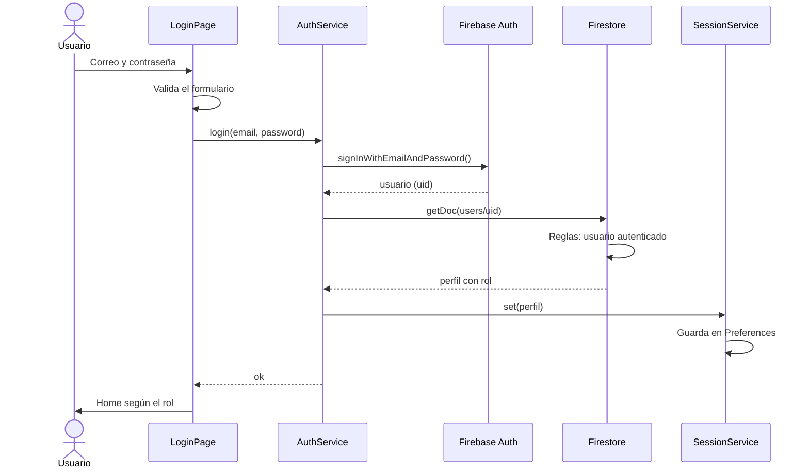
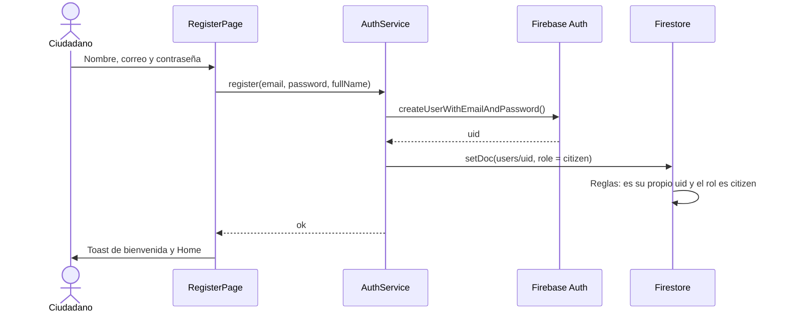
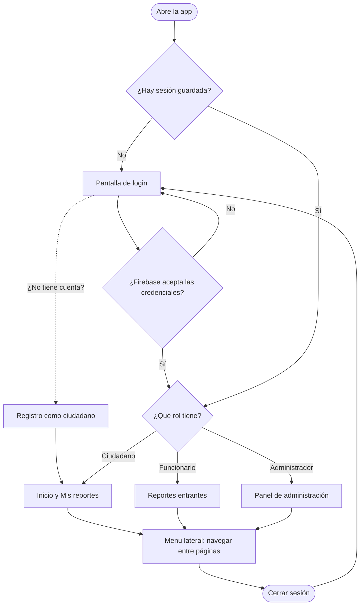
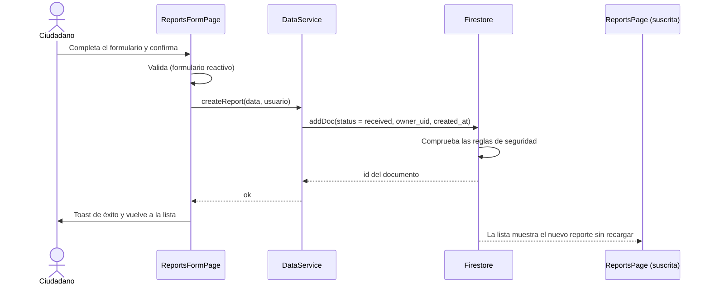
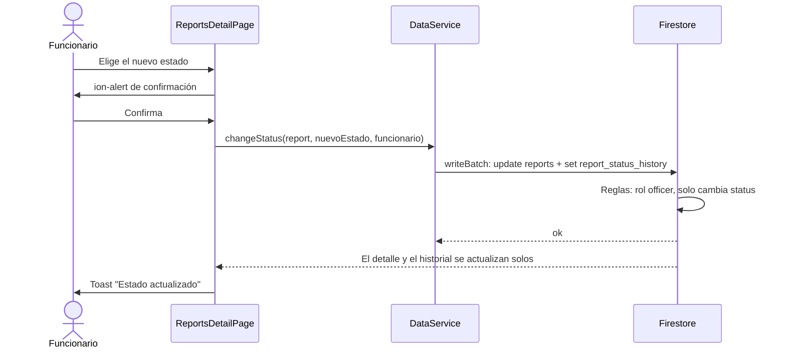
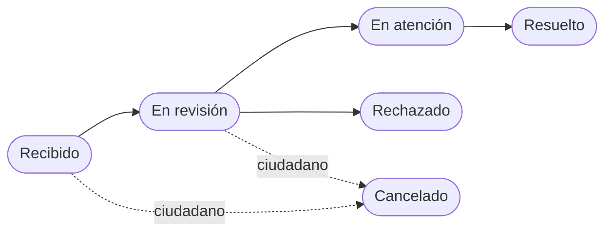

# Estructura de la app y navegación

## Diagrama de clases

Las páginas dependen de los servicios; los servicios usan los modelos y hablan con Firebase. Ninguna página llama al SDK directamente.

## Secuencia: inicio de sesión

La app se autentica con Firebase Authentication, lee el perfil (con el rol) en Firestore y lo guarda en el dispositivo para no volver a leerlo en cada pantalla.

Si la contraseña es incorrecta, Firebase devuelve un código como `auth/invalid-credential` y la página muestra un toast en español ("Correo o contraseña incorrectos.").

## Secuencia: registro

## Rutas

| Ruta | Página | Acceso |
|---|---|---|
| `/login` | LoginPage | Público |
| `/register` | RegisterPage | Público |
| `/home` | HomePage | Cualquier usuario con sesión |
| `/reports` | ReportsPage | Ciudadano |
| `/reports/new` | ReportsFormPage | Ciudadano |
| `/reports/:id` | ReportsDetailPage | Cualquier usuario con sesión (Firestore solo entrega el reporte al dueño, al funcionario y al admin) |
| `/management` | ManagementPage | Funcionario municipal |
| `/admin` | AdminPage | Administrador |
| `/map` | MapPage | Cualquier usuario con sesión |

`authGuard` revisa que haya sesión y `roleGuard` revisa además el rol indicado en `data.roles` de la ruta. Desde la Fase 2 el rol sale del perfil en Firestore (ya no es simulado), y las reglas de Firestore lo vuelven a comprobar del lado del servidor.

## Diagrama de flujo de la navegación

## Secuencia: crear un reporte (sin backend)

## Secuencia: el funcionario cambia el estado

## Ciclo de estados de un reporte

El funcionario mueve el reporte por el flujo; el ciudadano solo puede cancelarlo mientras está en `received` o `in_review`.

