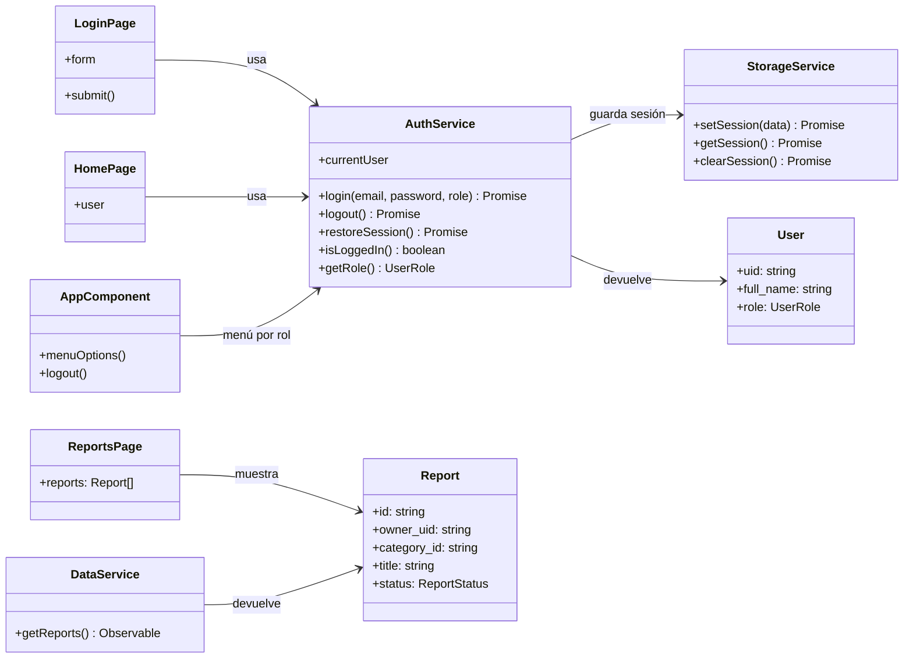
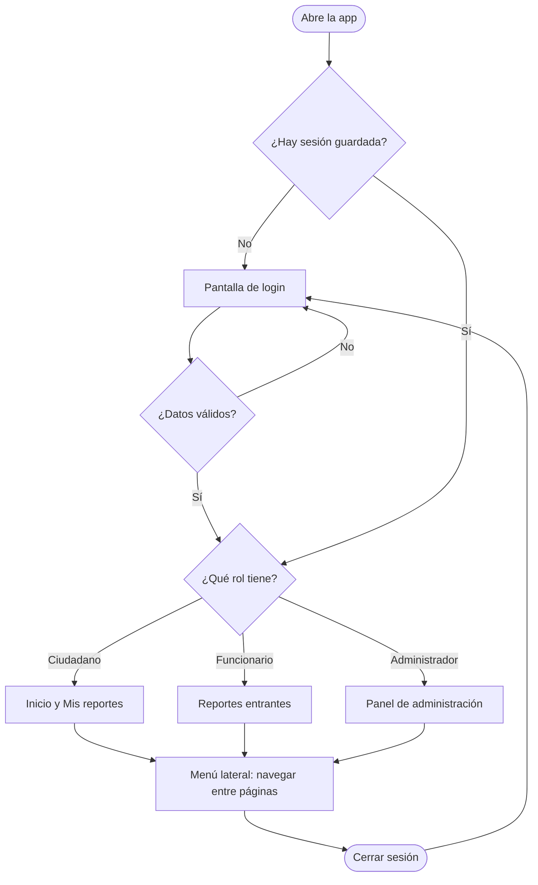
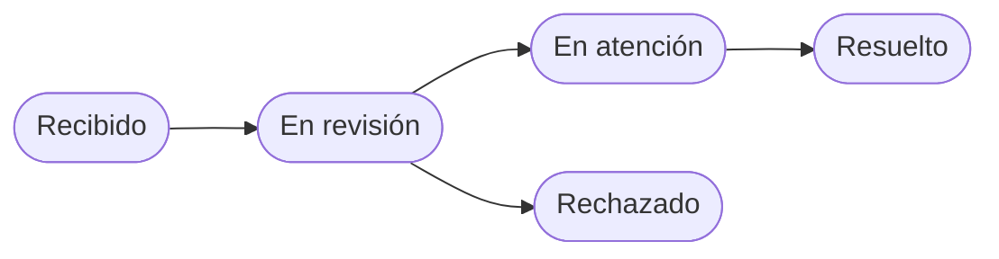

# Estructura de la app y navegación

## Diagrama de clases

Las páginas dependen de los servicios; los servicios usan los modelos y hablan con Firebase. Ninguna página llama al SDK directamente.

## Rutas

| Ruta | Página | Acceso |
|---|---|---|
| `/login` | LoginPage | Público |
| `/home` | HomePage | Cualquier usuario con sesión |
| `/reports` | ReportsPage | Ciudadano |
| `/management` | ManagementPage | Funcionario municipal |
| `/admin` | AdminPage | Administrador |
| `/map` | MapPage | Cualquier usuario con sesión |

`authGuard` revisa que haya sesión y `roleGuard` revisa además el rol indicado en `data.roles` de la ruta.

## Diagrama de flujo de la navegación

En la Fase 1 el inicio de sesión es simulado (el rol se elige en el formulario), pero el flujo ya está completo.

## Ciclo de estados de un reporte

