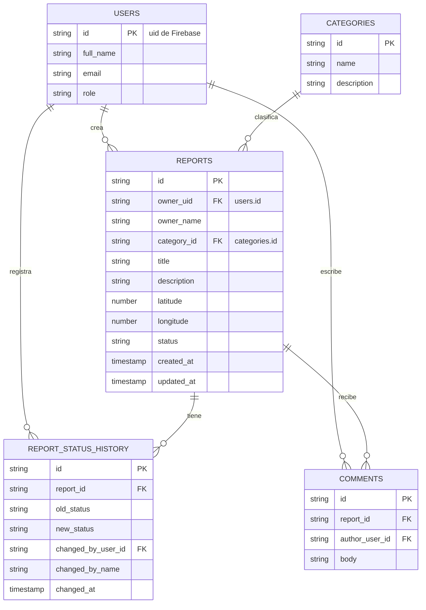

# Modelo de datos (Cloud Firestore)

Los datos se guardan en colecciones de documentos. No hay claves foráneas reales: un documento se relaciona con otro guardando su `id` en un campo.

## Diagrama entidad-relación

> El id de cada documento de `users` es el `uid` que entrega Firebase Authentication, por eso no hace falta un campo `firebase_uid` aparte. Por la misma razón el dueño del reporte se guarda como `owner_uid` (el uid del ciudadano): es el campo que revisan las reglas de seguridad.

## Diccionario de datos

### `users`

| Campo | Tipo | Oblig. | Descripción / regla |
|---|---|---|---|
| `id` | string (uid) | Sí | Id del documento = uid de Firebase Authentication. |
| `full_name` | string | Sí | Nombre completo del usuario. |
| `email` | string | Sí | Correo con el que se registró. |
| `role` | string | Sí | `citizen`, `officer` o `admin`. Al registrarse siempre es `citizen`; los otros roles los asigna el administrador. |
| `created_at` | number | Sí | Fecha de registro (milisegundos, `Date.now()`). |

### `categories`

| Campo | Tipo | Oblig. | Descripción / regla |
|---|---|---|---|
| `id` | string (id) | Sí | Identificador que genera Firestore. |
| `name` | string | Sí | Nombre de la categoría (Baches, Alumbrado público...). |
| `description` | string | No | Texto de ayuda para el ciudadano. |

### `reports`

| Campo | Tipo | Oblig. | Descripción / regla |
|---|---|---|---|
| `id` | string (id) | Sí | Identificador del documento que genera Firestore. |
| `owner_uid` | string (ref) | Sí | Ciudadano que crea el reporte. Referencia a `users`. Debe ser el uid de quien lo crea. |
| `owner_name` | string | Sí | Copia del nombre del ciudadano (denormalizado para no leer `users` en cada lista). |
| `category_id` | string (ref) | Sí | Tipo de incidencia. Referencia a `categories`. |
| `title` | string | Sí | Resumen corto de la incidencia (máx. 80 caracteres). |
| `description` | string | No | Detalle de la incidencia (máx. 500 caracteres). |
| `latitude` | number | Sí | Coordenada de la ubicación (-90 a 90). |
| `longitude` | number | Sí | Coordenada de la ubicación (-180 a 180). |
| `status` | string | Sí | `received`, `in_review`, `in_progress`, `resolved`, `rejected` o `cancelled`. Siempre nace en `received`. |
| `created_at` | timestamp | Sí | Fecha de creación (`serverTimestamp()`). |
| `updated_at` | timestamp | Sí | Fecha del último cambio de estado. |

`cancelled` es el borrado lógico: el ciudadano cancela su reporte en lugar de borrarlo, así se conserva el historial.

### `report_status_history`

| Campo | Tipo | Oblig. | Descripción / regla |
|---|---|---|---|
| `id` | string (id) | Sí | Identificador del documento. |
| `report_id` | string (ref) | Sí | Reporte al que pertenece el cambio. |
| `old_status` | string | Sí | Estado anterior. |
| `new_status` | string | Sí | Estado al que pasó el reporte. |
| `changed_by_user_id` | string (ref) | Sí | Funcionario que hizo el cambio. Debe ser el uid de quien escribe. |
| `changed_by_name` | string | Sí | Nombre del funcionario (denormalizado). |
| `changed_at` | timestamp | Sí | Momento del cambio (`serverTimestamp()`). |

El cambio de estado y su registro en el historial se guardan en un mismo `writeBatch`: o se guardan los dos o ninguno.

### Índices

Las consultas que filtran por un campo y ordenan por otro necesitan índice compuesto (están en `firestore.indexes.json` y se publican con `firebase deploy --only firestore:indexes`):

| Colección | Campos |
|---|---|
| `reports` | `owner_uid` ASC, `created_at` DESC |
| `report_status_history` | `report_id` ASC, `changed_at` ASC |

### `comments`

| Campo | Tipo | Oblig. | Descripción / regla |
|---|---|---|---|
| `id` | string (id) | Sí | Identificador del documento. |
| `report_id` | string (ref) | Sí | Reporte comentado. |
| `author_user_id` | string (ref) | Sí | Autor del comentario. |
| `body` | string | Sí | Texto del comentario. |

## Reglas de seguridad

Las reglas están en [`firestore.rules`](../firestore.rules).

- Toda lectura exige usuario autenticado.
- `users`: cada quien crea solo su propio perfil y únicamente con rol `citizen`. Puede editar sus datos pero no cambiarse el rol; solo un `admin` cambia el rol de otro usuario. Los perfiles no se borran desde la app.
- `reports`:
  - **Leer:** el ciudadano solo ve sus reportes; el funcionario y el administrador ven todos.
  - **Crear:** solo a su propio nombre (`owner_uid`), en estado `received` y con título, categoría y coordenadas válidas.
  - **Actualizar:** solo pueden cambiar `status` y `updated_at`. El funcionario puede poner cualquier estado válido; el dueño solo puede pasarlo a `cancelled` y únicamente si está en `received` o `in_review`.
  - **Borrar:** nadie (se usa borrado lógico).
- `report_status_history`: lo crea solo el funcionario a su propio nombre; lo leen el funcionario, el admin y el dueño del reporte. No se modifica ni se borra.
- `categories` es de solo lectura desde la app.
- Cualquier colección no declarada queda cerrada.

La función `role()` de las reglas lee el rol desde `users/{uid}` del usuario que hace la petición. Así el rol lo decide Firestore y no el teléfono: aunque alguien modifique la app, no puede darse permisos que no tiene.

### Cómo se probaron

Con los emuladores (`firebase emulators:start --only auth,firestore`) se probaron estos casos:

| Caso | Resultado esperado |
|---|---|
| Crear su propio perfil con rol `admin` | Rechazado |
| Crear su propio perfil con rol `citizen` | Permitido |
| Cambiar su nombre | Permitido |
| Cambiarse el rol a `admin` | Rechazado |
| Crear el perfil de otro usuario | Rechazado |
| Un `admin` cambia el rol de otro usuario | Permitido |
| Borrar un perfil | Rechazado |
| Escribir en `categories` desde la app | Rechazado |
| Ciudadano crea un reporte propio en `received` | Permitido |
| Ciudadano crea un reporte ya `resolved` | Rechazado |
| Ciudadano crea un reporte a nombre de otro | Rechazado |
| Crear un reporte sin título | Rechazado |
| Ciudadano lista sus reportes (`where owner_uid`) | Permitido |
| Otro ciudadano lee un reporte ajeno | Rechazado |
| Ciudadano cambia su reporte a `in_progress` | Rechazado |
| Otro ciudadano cancela un reporte ajeno | Rechazado |
| Funcionario lista todos los reportes | Permitido |
| Funcionario cambia el estado y escribe el historial (batch) | Permitido |
| Funcionario cambia el título | Rechazado |
| Funcionario pone un estado que no existe | Rechazado |
| Ciudadano escribe en el historial | Rechazado |
| Ciudadano lee el historial de su reporte | Permitido |
| Ciudadano cancela su reporte en `in_review` | Permitido |
| Borrado físico de un reporte | Rechazado |
