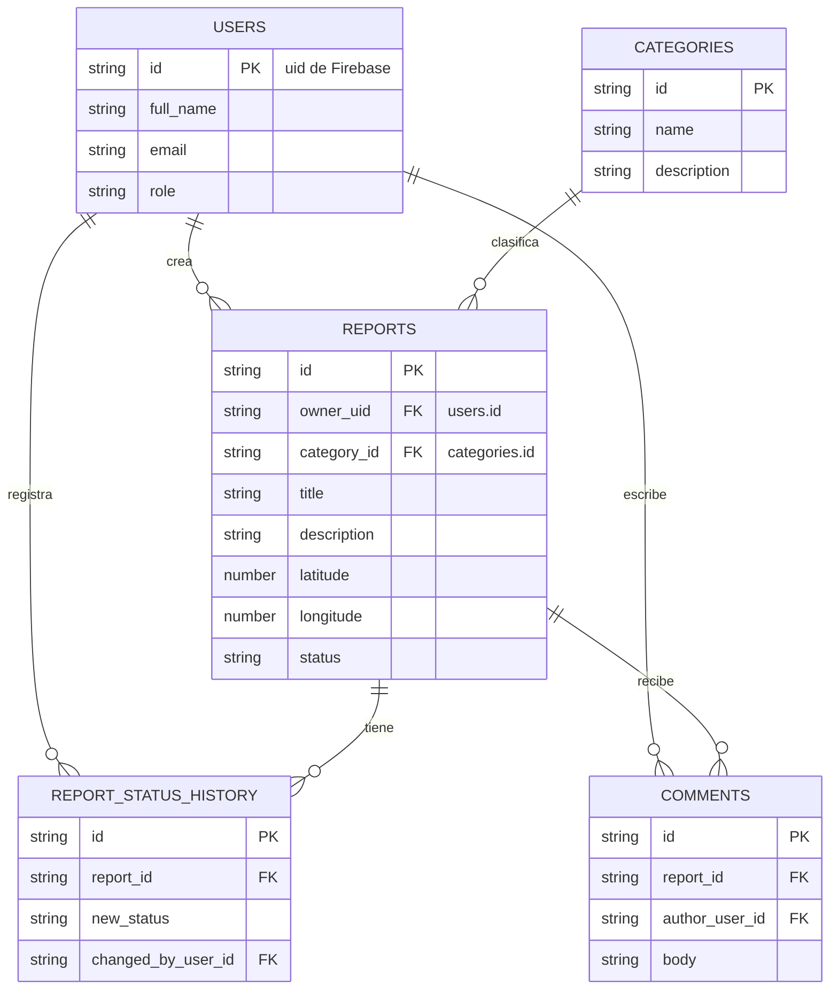

# Modelo de datos (Cloud Firestore)

Los datos se guardan en colecciones de documentos. No hay claves foráneas reales: un documento se relaciona con otro guardando su `id` en un campo.

## Diagrama entidad-relación

> El id de cada documento de `users` es el `uid` que entrega Firebase Authentication, por eso no hace falta un campo `firebase_uid` aparte. Por la misma razón el dueño del reporte se guarda como `owner_uid` (el uid del ciudadano): es el campo que revisan las reglas de seguridad.

## Diccionario de datos

### `users`

| Campo | Tipo | Oblig. | Descripción / regla |
|---|---|---|---|
| `id` | string (uid) | Sí | Id del documento = uid de Firebase Authentication. |
| `full_name` | string | Sí | Nombre completo del usuario. |
| `email` | string | Sí | Correo con el que se registró. |
| `role` | string | Sí | `citizen`, `officer` o `admin`. |

### `categories`

| Campo | Tipo | Oblig. | Descripción / regla |
|---|---|---|---|
| `id` | string (id) | Sí | Identificador que genera Firestore. |
| `name` | string | Sí | Nombre de la categoría (Baches, Alumbrado público...). |
| `description` | string | No | Texto de ayuda para el ciudadano. |

### `reports`

| Campo | Tipo | Oblig. | Descripción / regla |
|---|---|---|---|
| `id` | string (id) | Sí | Identificador del documento que genera Firestore. |
| `owner_uid` | string (ref) | Sí | Ciudadano que crea el reporte. Referencia a `users`. |
| `category_id` | string (ref) | Sí | Tipo de incidencia. Referencia a `categories`. |
| `title` | string | Sí | Resumen corto de la incidencia. |
| `description` | string | No | Detalle de la incidencia. |
| `latitude` | number | Sí | Coordenada de la ubicación del reporte. |
| `longitude` | number | Sí | Coordenada de la ubicación del reporte. |
| `status` | string | Sí | `received`, `in_review`, `in_progress`, `resolved` o `rejected`. |

### `report_status_history`

| Campo | Tipo | Oblig. | Descripción / regla |
|---|---|---|---|
| `id` | string (id) | Sí | Identificador del documento. |
| `report_id` | string (ref) | Sí | Reporte al que pertenece el cambio. |
| `new_status` | string | Sí | Estado al que pasó el reporte. |
| `changed_by_user_id` | string (ref) | Sí | Funcionario que hizo el cambio. |

### `comments`

| Campo | Tipo | Oblig. | Descripción / regla |
|---|---|---|---|
| `id` | string (id) | Sí | Identificador del documento. |
| `report_id` | string (ref) | Sí | Reporte comentado. |
| `author_user_id` | string (ref) | Sí | Autor del comentario. |
| `body` | string | Sí | Texto del comentario. |

## Reglas de seguridad

Las reglas están en [`firestore.rules`](../firestore.rules). En esta fase:

- Toda lectura exige usuario autenticado.
- Cada usuario solo escribe su propio documento de `users`.
- Un reporte solo se puede crear si `owner_uid` coincide con el uid de quien lo crea, y solo su dueño lo modifica o borra.
- `categories` es de solo lectura desde la app.
- Cualquier colección no declarada queda cerrada.
